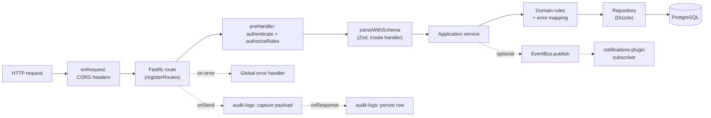

# Backend Architecture

How a request travels through the `edunic-api`, and why each layer exists.

This document describes the **current** backend as it is checked into the repository: a modular
monolith built on Fastify, Drizzle ORM and PostgreSQL, with an in-process domain event bus that can
be switched to Redis Streams. Everything below is verified against the code — file paths and symbols
are real. Where the broader architecture plan calls for a component that **is not built yet**, it is
marked **Planned (P2)** or **Planned (P4/P5)** and kept out of the "current" sections, so the reader
never mistakes intent for reality.

- API app: `apps/edunic-api`
- Domain logic: `libs/domain` (19 modules)
- Database: `libs/db`
- Event bus: `libs/events`

## At a glance

| Layer | Lives in | Owns |
|-------|----------|------|
| HTTP / plugins | `apps/edunic-api/src/plugins` | Cross-cutting concerns: CORS, DB pool, event bus, auth, audit, response envelope, error handling, notifications |
| Routes | `apps/edunic-api/src/routes` | HTTP shape: paths, methods, status codes, input parsing |
| Application services | `libs/domain/src/<module>/application` | Use-case orchestration, business rules, error mapping |
| Repositories | `libs/domain/src/<module>/infrastructure` | All database access (Drizzle) |
| Schema / migrations | `libs/db/src` | Tables, constraints, migrations |
| Events | `libs/events`, `libs/domain/src/events.ts` | Domain event contracts and the bus |

## 1. Request flow

A synchronous request moves through the layers below. Each layer exists to keep a single
responsibility, so a change in one does not ripple through the others.

| Step | Where | Why it exists |
|------|-------|---------------|
| CORS | `plugins/cors.plugin.ts` (`onRequest`) | Answers preflight `OPTIONS` and adds CORS headers before any route logic runs. |
| Route | `routes/*.routes.ts` | The HTTP contract only: path, method, status code, wiring. No business logic. |
| Auth | `plugins/auth.plugin.ts` (`preHandler`) | Verifies the JWT and resolves the caller's role before the handler runs. |
| Validation | `libs/domain/src/shared/parse-with-schema.ts` | Rejects malformed input at the boundary. Called **inside each route handler**, not as a Fastify `preValidation` hook. |
| Service | `libs/domain/src/<module>/application/*.service.ts` | Orchestrates the use case, enforces rules, maps DB errors to HTTP status codes. |
| Repository | `libs/domain/src/<module>/infrastructure/*.repository.ts` | The only place that talks to the database. Every query filters by `institutionId`. |
| Events | `libs/events`, service constructor | Publishes domain events after a state change so other parts of the system can react. |

**Worked example (`POST /enrollments`):** `apps/edunic-api/src/routes/enrollments.routes.ts` builds
`EnrollmentsService` with `EnrollmentsRepository` and `app.eventBus`, gates it behind
`app.authenticate` + `app.authorizeRoles(['admin', 'teacher'])`, parses the body with
`parseWithSchema(createEnrollmentBodySchema, request.body)`, then calls
`createEnrollment()`. The service (`libs/domain/src/enrollments/application/enrollments.service.ts`)
verifies related rows exist, writes through the repository, and finally
`eventBus.publish(createEnrollmentCreatedEvent(...))`.

**Current error handling.** `apps/edunic-api/src/plugins/error-handler.plugin.ts` owns the global
Fastify error handler (the bare `{ message }` handler that used to live in `app.ts` was removed). An
`onRequest` hook assigns every request a `correlationId` (UUID), and errors are answered with an
`ErrorEnvelope` — `{ code, message, details?, correlationId }`, built by `createErrorEnvelope()` in
`libs/domain/src/shared/http/response-envelope.ts`. `code` comes from the stable `ErrorCode` enum
(eight members): `400` → `VALIDATION_ERROR`, `401` → `UNAUTHORIZED`, `403` → `FORBIDDEN`,
`404` → `NOT_FOUND`, `409` → `CONFLICT`, `503` → `SERVICE_UNAVAILABLE`; an unmapped 5xx becomes
`INTERNAL_ERROR`, any other unmapped 4xx reuses `VALIDATION_ERROR` (so `429` keeps its HTTP status
while reusing the generic client-error code). Errors that carry an explicit `statusCode` keep their
own message; everything else is masked to `Internal Server Error` so internals never leak. Error
replies are never enveloped — the envelope plugin skips status `>= 400`.

## 2. Plugin registration order

Plugins are registered in `apps/edunic-api/src/plugins/index.ts`, and the order is significant.

**Current order (as registered):**

| # | Plugin | File | Why here |
|---|--------|------|----------|
| 1 | `corsPlugin` | `cors.plugin.ts` | Must add its `onRequest` hook first so headers are present even on early responses and errors. |
| 2 | `dbPlugin` | `db.plugin.ts` | Decorates `app.db` and opens the pool. Auth and audit-logs declare it as a dependency, so it must load first. |
| 3 | `eventBusPlugin` | `event-bus.plugin.ts` | Decorates `app.eventBus`. The notifications subscriber depends on it. |
| 4 | `authPlugin` | `auth.plugin.ts` | Depends on `db-plugin`; decorates `authenticate` and `authorizeRoles` used by route `preHandler`s. |
| 5 | `auditLogsPlugin` | `audit-logs.plugin.ts` | Depends on `db-plugin`; registers the `onSend` (capture) and `onResponse` (persist) hooks. |
| 6 | `envelopePlugin` | `envelope.plugin.ts` | Registered right after `audit-logs` so the audit `onSend` hook captures the raw payload first. Wraps JSON success bodies in `{ data }`; idempotent (bodies with a top-level `data` key pass through) and skips errors, non-JSON payloads, and `/health`, `/docs`, `/auth/login`. |
| 7 | `idempotencyPlugin` | `idempotency.plugin.ts` | After `envelope-plugin`: its `onSend` hook must store the post-envelope payload for `Idempotency-Key` replay. |
| 8 | `errorHandlerPlugin` | `error-handler.plugin.ts` | Provides the global error handler and the per-request `correlationId` `onRequest` hook. Declares no `fastify-plugin` dependencies (only a plugin `name`), so registration order alone fixes its position after `idempotency`. |
| 9 | `outboxPublisherPlugin` | `outbox-publisher.plugin.ts` | Depends on `db-plugin` and `event-bus-plugin`; polls `outbox_events` every 500 ms and publishes unpublished rows. Registered before `notifications` so deliveries are flowing before subscribers attach. |
| 10 | `notificationsPlugin` | `notifications.plugin.ts` | Depends on `db-plugin` and `event-bus-plugin`; subscribes to the three domain events. |

Two mechanisms enforce this: the explicit `app.register(...)` order above, and `fastify-plugin`
`dependencies` (`auth-plugin` → `db-plugin`; `audit-logs-plugin` → `db-plugin`;
`idempotency-plugin` → `db-plugin`, `event-bus-plugin`; `outbox-publisher-plugin` → `db-plugin`,
`event-bus-plugin`; `notifications-plugin` → `db-plugin`, `event-bus-plugin`). A dependent plugin
cannot load before the plugin it depends on. The convention is that a plugin which *provides* a
decorator is registered before any plugin that consumes it. `envelope-plugin` and
`error-handler-plugin` declare no `dependencies` — only a `name` — so their position is fixed by
registration order alone.

`notifications` stays last in both the current and planned orders.

## 3. Auth, RBAC and multi-tenancy

### Authentication (JWT)

- Tokens are signed and verified with **`jose`** (HS256), in `libs/domain/src/auth/application/jwt.ts`
  (`signJwt`, `verifyJwt`).
- The payload is `{ sub, institutionId, exp }`; tokens expire after 12 hours by default.
- `plugins/auth.plugin.ts` decorates `app.authenticate`. It reads the `Authorization: Bearer` header,
  calls `verifyJwt(token, env.JWT_SECRET)`, then loads the user's role for the token's institution via
  `AuthRepository.findUserRole`. Missing/invalid tokens return `401`; a missing role returns `403`.
- `AuthService.login` (`libs/domain/src/auth/application/auth.service.ts`) verifies the password hash
  and issues the token.

### Authorization (RBAC)

- `app.authorizeRoles([...])` returns a `preHandler` that returns `403` unless `request.user.role` is
  in the allowed list.
- Roles in use include `admin`, `teacher` and `parent` (see
  `apps/edunic-api/src/routes/enrollments.routes.ts`).
- Protection is opt-in per route: each route attaches `preHandler: [app.authenticate, app.authorizeRoles([...])]`.
  There is no global "all routes are protected" default, so every new route must add it explicitly.

### Multi-tenancy

- Every core table carries `institution_id` with a foreign key to `institutions`
  (`libs/db/src/schema/index.ts`).
- The tenant is read from the **`x-institution-id`** header via
  `getInstitutionId(request)` (`libs/domain/src/shared/institution.ts`), which validates it as a UUID.
- To close the cross-tenant hole, `authenticate` (in `plugins/auth.plugin.ts`) rejects the request with
  `403` when the `x-institution-id` header does not match the institution embedded in the token.
- Repositories receive `institutionId` and include it in the `where` clause of every query, so tenant
  isolation is enforced at the data-access layer as well as at the edge.

## 4. Database patterns

- **ORM:** Drizzle over `pg` (`drizzle-orm/node-postgres`).
- **Connection:** `createDb()` in `libs/db/src/create-db.ts` builds a `pg.Pool` and returns
  `{ pool, db }`. It reads `DATABASE_URL`, and sets `allowExitOnIdle` in test runs. `plugins/db.plugin.ts`
  calls it, decorates `app.db`, and closes the pool on `onClose`.
- **Schema:** a single `libs/db/src/schema/index.ts` defines all tables as `pgTable` definitions,
  including the constraints that enforce data integrity:
  - `unique` — e.g. one enrollment per student per academic period (`uniqueStudentPeriod`), one
    attendance row per enrollment per day (`uniqueEnrollmentDate`), unique `(year, term)` per institution.
  - `check` — e.g. grade `score` between 0 and 100, attendance `status` in `('present','absent','late')`,
    academic period `term` between 1 and 4, `startDate <= endDate`.
  - foreign keys on `institution_id` and relationships (`student_id`, `enrollment_id`, …).
- **Migrations:** SQL files under `libs/db/src/migrations` (`0000`–`0005`), with Drizzle's
  `meta/_journal.json`. `drizzle-kit` config lives in `libs/db/src/drizzle.config.ts` (schema
  `./libs/db/src/schema`, out `./libs/db/src/migrations`). `runMigrations()`
  (`libs/db/src/run-migrations.ts`) applies them with `migrate()` against `DATABASE_URL`. There is
  currently **no down migration** and no rollback runbook — **Planned (P4)**.
- **Errors:** services map known Postgres codes to HTTP status codes, e.g. unique-violation `23505`
  becomes `409` in `EnrollmentsService.handlePersistenceError`.

**Not yet present:** database transactions. Multi-write operations (for example "create enrollment +
publish event") are not atomic today — transactional outbox is **Planned (P2)**.

**Caveat:** importing `libs/db/src/index.ts` (`@edunic/source/db`) executes a module-level
`createDb()` that exports a singleton `{ pool, db }`. Because `plugins/db.plugin.ts` imports from the
same entry, that module side effect also runs at startup. Use `createDb()` explicitly for new code and
be aware of the eager singleton.

### List conventions (cursor pagination, filter and sort)

List endpoints follow two shared conventions implemented in
`libs/domain/src/shared/http/{pagination,filter-sort}.ts` and wired on the enrollments, grades,
attendance and students routes:

- **Dual-parameter pagination.** `?cursor=<value>&limit=<n>` selects keyset (cursor) pagination;
  omitting `cursor` keeps the legacy `offset`/`limit` mode, which the route flags with an
  `X-Pagination-Deprecated: offset` response header. `cursor=start` is a sentinel requesting the
  first page in stable keyset order — real cursors are base64url JSON (`{ k, i }`, with `k` a
  composite array for multi-column orders) and can never equal `start`. A malformed cursor, or one
  whose key arity does not match the resource's stable order, is rejected with `400`
  `VALIDATION_ERROR`.
- **Keyset mechanics.** Repositories call `applyCursorPagination()` to get a constant per-resource
  stable `ORDER BY`, a bound-parameter keyset predicate, and a `limit + 1` sentinel row that detects
  `hasMore` without running `count(*)`. Cursor mode omits `meta.total`; legacy mode keeps the
  existing `{ data, meta: { total, limit, offset } }` contract.
- **Response shape.** Services return `CursorPage<T>` — `{ data, hasMore, nextCursor?, meta? }` —
  assembled by `buildCursorPage()`. Because it carries a top-level `data` key, the envelope plugin
  passes it through unchanged.
- **Uniform filter and sort.** List queries accept repeatable `filter=field:operator:value`
  (`eq`, `neq`, `gt`, `gte`, `lt`, `lte`, `contains`, `in`) and `sort=field:direction`, parsed by
  `parseFilterSort()`. Field names are validated against a per-resource whitelist and mapped to
  constant column literals; values always travel as bound parameters, so identifiers from user input
  never reach SQL construction. In cursor mode the stable keyset order takes precedence over `sort`.

## 5. Events and Redis

### Contracts and bus

`libs/events/src/index.ts` defines:

- `EventEnvelope<TName, TPayload>` — `{ id, name, institutionId, payload, occurredAt }`.
- `createEventEnvelope(...)` — assigns a UUID and timestamp.
- `EventBus` — `publish(event)` and `subscribe(eventName, handler)`.
- `InMemoryEventBus` — the **default**. Handlers run in-process, synchronously.
- `RedisStreamsEventBus` — used when `EVENT_BUS_BACKEND=redis`.
- `createEventBusFromEnv()` — returns the Redis bus when `EVENT_BUS_BACKEND=redis`, otherwise the
  in-memory bus. It throws if `REDIS_URL` is unset in Redis mode. `plugins/event-bus.plugin.ts`
  decorates `app.eventBus` with the result.

### Domain events

`libs/domain/src/events.ts` declares three events, each with a typed payload and a factory:

| Event | Factory | Payload |
|-------|---------|---------|
| `enrollment.created` | `createEnrollmentCreatedEvent` | `enrollmentId`, `studentId`, `academicPeriodId`, `classroomId` |
| `grade.submitted` | `createGradeSubmittedEvent` | `gradeId`, `enrollmentId`, `subject`, `score` |
| `attendance.marked` | `createAttendanceMarkedEvent` | `attendanceId`, `enrollmentId`, `date`, `status` |

`plugins/notifications.plugin.ts` subscribes to all three and forwards each to
`NotificationsService.handleDomainEvent`, which writes a `notifications` row when the institution has
the notifications extension enabled.

### Redis

- Redis is used **only** by the event bus today. In Redis mode, `RedisStreamsEventBus.publish` calls
  Redis `XADD` on the stream `edunic:domain-events` (override with `EVENT_STREAM_NAME`) using
  `ioredis`, then also dispatches to its in-memory subscribers.
- Honest limitation: `RedisStreamsEventBus.subscribe` still delegates to the in-memory bus. The Redis
  backend **writes** to the stream but nothing **reads** from it yet — the consumer/worker is
  **Planned (P5)** (`apps/edunic-worker`).
- Redis is not used for caching or rate limiting; it backs the `Idempotency-Key` store (shipped).

## Current vs planned (summary)

| Component | Status | Where / when |
|-----------|--------|--------------|
| Request → route → validation → service → repository → DB | Current | This document, section 1 |
| Plugins: cors, db, event-bus, auth, audit-logs, envelope, idempotency, error-handler, outbox-publisher, notifications | Current | `plugins/index.ts` |
| JWT auth + RBAC + `institution_id` scoping | Current | `plugins/auth.plugin.ts`, shared/institution |
| Drizzle schema + migrations | Current | `libs/db/src` |
| In-memory event bus, 3 domain events, notifications subscriber | Current | `libs/events`, `libs/domain/src/events.ts` |
| Response envelope + error codes | Current | `libs/domain/src/shared/http/response-envelope.ts`, `plugins/envelope.plugin.ts`, `plugins/error-handler.plugin.ts` |
| Cursor pagination / filter-sort | Current | `libs/domain/src/shared/http/{pagination,filter-sort}.ts` (section 4, "List conventions") |
| Idempotency keys (Redis) | Current | `libs/domain/src/shared/http/idempotency.ts`, `idempotency.plugin.ts` |
| Transactional outbox + publisher | Current | `libs/db` `outbox_events` (migration 0006), `libs/domain/src/shared/outbox.ts`, `outbox-publisher.plugin.ts` |
| Tests (unit / integration / API / DB / E2E) | Planned (P3) | `apps/edunic-api/test` |
| Docker / Railway / `/health`, `/ready` | Planned (P4) | repo root, `health.routes.ts` |
| Worker + Redis Streams consumer | Planned (P5) | `apps/edunic-worker` |

## Reference

- Plugins: `apps/edunic-api/src/plugins/`
- Routes: `apps/edunic-api/src/routes/` (21 route modules registered in `index.ts`)
- App bootstrap: `apps/edunic-api/src/app.ts`, `apps/edunic-api/src/main.ts`
- Domain modules: `libs/domain/src/`
- DB: `libs/db/src/`
- Events: `libs/events/src/index.ts`, `libs/domain/src/events.ts`
