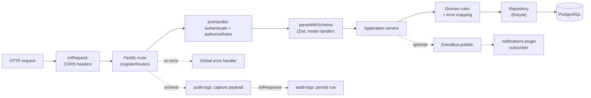

# Backend Architecture

How a request travels through the `edunic-api`, and why each layer exists.

This document describes the **current** backend as it is checked into the repository: a modular
monolith built on Fastify, Drizzle ORM and PostgreSQL, with an in-process domain event bus that can
be switched to Redis Streams. Everything below is verified against the code — file paths and symbols
are real. Where the broader architecture plan called for a component that **was not built yet**, it
carried a **Planned (P<phase>)** label and stayed out of the "current" sections, so the reader never
mistook intent for reality; no such label remains, every row in the summary below is shipped.

- API app: `apps/edunic-api`
- Domain logic: `libs/domain` (19 modules)
- Database: `libs/db`
- Event bus: `libs/events`

## At a glance

| Layer | Lives in | Owns |
|-------|----------|------|
| HTTP / plugins | `apps/edunic-api/src/plugins` | Cross-cutting concerns: CORS, DB pool, event bus, auth, audit, response envelope, idempotency, error handling, outbox publishing, notifications |
| Routes | `apps/edunic-api/src/routes` | HTTP shape: paths, methods, status codes, input parsing |
| Application services | `libs/domain/src/<module>/application` | Use-case orchestration, business rules, error mapping |
| Repositories | `libs/domain/src/<module>/infrastructure` | All database access (Drizzle) |
| Schema / migrations | `libs/db/src` | Tables, constraints, migrations |
| Events | `libs/events`, `libs/domain/src/events.ts` | Domain event contracts and the bus |

## 1. Request flow

A synchronous request moves through the layers below. Each layer exists to keep a single
responsibility, so a change in one does not ripple through the others.



| Step | Where | Why it exists |
|------|-------|---------------|
| CORS | `plugins/cors.plugin.ts` (`onRequest`) | Answers preflight `OPTIONS` and adds CORS headers before any route logic runs. |
| Route | `routes/*.routes.ts` | The HTTP contract only: path, method, status code, wiring. No business logic. |
| Auth | `plugins/auth.plugin.ts` (`preHandler`) | Verifies the JWT and resolves the caller's role before the handler runs. |
| Validation | `libs/domain/src/shared/parse-with-schema.ts` | Rejects malformed input at the boundary. Called **inside each route handler**, not as a Fastify `preValidation` hook. |
| Service | `libs/domain/src/<module>/application/*.service.ts` | Orchestrates the use case, enforces rules, maps DB errors to HTTP status codes. |
| Repository | `libs/domain/src/<module>/infrastructure/*.repository.ts` | The only place that talks to the database. Every tenant-scoped query filters by `institutionId`; the catalog reads that deliberately do not are listed in section 4. |
| Events | `libs/events`, service constructor | Publishes domain events after a state change so other parts of the system can react. |

**Worked example (`POST /enrollments`):** `apps/edunic-api/src/routes/enrollments.routes.ts` builds
`EnrollmentsService` with `EnrollmentsRepository` and `app.eventBus`, gates it behind
`app.authenticate` + `app.authorizeRoles(['admin', 'teacher'])`, parses the body with
`parseWithSchema(createEnrollmentBodySchema, request.body)`, then calls
`createEnrollment()`. The service (`libs/domain/src/enrollments/application/enrollments.service.ts`)
verifies related rows exist, writes through the repository, and finally
`eventBus.publish(createEnrollmentCreatedEvent(...))`.

**The asynchronous tail.** Everything after `eventBus.publish` leaves the request: the outbox row →
stream → worker chain, and the two worker-side effects it drives (the in-app notification row and the
email delivery stage) are described in section 5.

**Current error handling.** `apps/edunic-api/src/plugins/error-handler.plugin.ts` owns the global
Fastify error handler (the bare `{ message }` handler that used to live in `app.ts` was removed). An
`onRequest` hook assigns every request a `correlationId` (UUID), and errors are answered with an
`ErrorEnvelope` — `{ code, message, details?, correlationId }`, built by `createErrorEnvelope()` in
`libs/domain/src/shared/http/response-envelope.ts`. `code` comes from the stable `ErrorCode` enum
(eight members): `400` → `VALIDATION_ERROR`, `401` → `UNAUTHORIZED`, `403` → `FORBIDDEN`,
`404` → `NOT_FOUND`, `409` → `CONFLICT`, `503` → `SERVICE_UNAVAILABLE`; an unmapped 5xx becomes
`INTERNAL_ERROR`, any other unmapped 4xx reuses `VALIDATION_ERROR` (so `429` keeps its HTTP status
while reusing the generic client-error code). Errors that carry an explicit `statusCode` keep their
own message; everything else is masked to `Internal Server Error` so internals never leak. Error
replies are never enveloped — the envelope plugin skips status `>= 400`.

## 2. Plugin registration order

Plugins are registered in `apps/edunic-api/src/plugins/index.ts`, and the order is significant.

**Current order (as registered):**

| # | Plugin | File | Why here |
|---|--------|------|----------|
| 1 | `corsPlugin` | `cors.plugin.ts` | Must add its `onRequest` hook first so headers are present even on early responses and errors. |
| 2 | `dbPlugin` | `db.plugin.ts` | Decorates `app.db` and opens the pool. Auth and audit-logs declare it as a dependency, so it must load first. |
| 3 | `eventBusPlugin` | `event-bus.plugin.ts` | Decorates `app.eventBus`. The notifications subscriber depends on it. |
| 4 | `authPlugin` | `auth.plugin.ts` | Depends on `db-plugin`; decorates `authenticate` and `authorizeRoles` used by route `preHandler`s. |
| 5 | `auditLogsPlugin` | `audit-logs.plugin.ts` | Depends on `db-plugin`; registers the `onSend` (capture) and `onResponse` (persist) hooks. |
| 6 | `envelopePlugin` | `envelope.plugin.ts` | Registered right after `audit-logs` so the audit `onSend` hook captures the raw payload first. Wraps JSON success bodies in `{ data }`; idempotent (bodies with a top-level `data` key pass through) and skips errors, non-JSON payloads, and `/health`, `/ready`, `/docs`, `/auth/login`. |
| 7 | `idempotencyPlugin` | `idempotency.plugin.ts` | After `envelope-plugin`: its `onSend` hook must store the post-envelope payload for `Idempotency-Key` replay. |
| 8 | `errorHandlerPlugin` | `error-handler.plugin.ts` | Provides the global error handler and the per-request `correlationId` `onRequest` hook. Declares no `fastify-plugin` dependencies (only a plugin `name`), so registration order alone fixes its position after `idempotency`. |
| 9 | `outboxPublisherPlugin` | `outbox-publisher.plugin.ts` | Depends on `db-plugin` and `event-bus-plugin`; polls `outbox_events` every 500 ms and publishes unpublished rows. Registered before `notifications` so deliveries are flowing before subscribers attach. |
| 10 | `notificationsPlugin` | `notifications.plugin.ts` | Depends on `db-plugin` and `event-bus-plugin`; subscribes to the three domain events. |

Two mechanisms enforce this: the explicit `app.register(...)` order above, and `fastify-plugin`
`dependencies` (`auth-plugin` → `db-plugin`; `audit-logs-plugin` → `db-plugin`;
`outbox-publisher-plugin` → `db-plugin`, `event-bus-plugin`; `notifications-plugin` → `db-plugin`,
`event-bus-plugin`). A dependent plugin cannot load before the plugin it depends on. The convention is
that a plugin which *provides* a decorator is registered before any plugin that consumes it.
`envelope-plugin`, `idempotency-plugin` and `error-handler-plugin` declare no `dependencies` — only a
`name` — so their position is fixed by registration order alone; that is why the ordering comments sit
next to the `envelope` → `idempotency` pair in `plugins/index.ts`.

`/health` and `/ready` are both registered from `health.routes.ts`: `/health` via `healthRoutes` under
the `/health` prefix, `/ready` via `readyRoutes` at the root. Both paths are listed in
`envelope.plugin.ts`'s `isExcludedPath`, so their bodies are never wrapped in the response envelope.

`notifications` stays last.

## 3. Auth, RBAC and multi-tenancy

### Authentication (JWT)

- Tokens are signed and verified with **`jose`** (HS256), in `libs/domain/src/auth/application/jwt.ts`
  (`signJwt`, `verifyJwt`).
- The payload is `{ sub, institutionId, exp }`; tokens expire after 12 hours by default.
- `plugins/auth.plugin.ts` decorates `app.authenticate`. It reads the `Authorization: Bearer` header,
  calls `verifyJwt(token, env.JWT_SECRET)`, then loads the user's role for the token's institution via
  `AuthRepository.findUserRole`. Missing/invalid tokens return `401`; a missing role returns `403`.
- `AuthService.login` (`libs/domain/src/auth/application/auth.service.ts`) verifies the password hash
  and issues the token.

### Authorization (RBAC)

- `app.authorizeRoles([...])` returns a `preHandler` that returns `403` unless `request.user.role` is
  in the allowed list.
- Roles in use include `admin`, `teacher` and `parent` (see
  `apps/edunic-api/src/routes/enrollments.routes.ts`).
- Protection is opt-in per route: each route attaches `preHandler: [app.authenticate, app.authorizeRoles([...])]`.
  There is no global "all routes are protected" default, so every new route must add it explicitly.

### Multi-tenancy

- Every core table carries `institution_id` with a foreign key to `institutions`
  (`libs/db/src/schema/index.ts`).
- The tenant is read from the **`x-institution-id`** header via
  `getInstitutionId(request)` (`libs/domain/src/shared/institution.ts`), which validates it as a UUID.
- To close the cross-tenant hole, `authenticate` (in `plugins/auth.plugin.ts`) rejects the request with
  `403` when the `x-institution-id` header does not match the institution embedded in the token.
- Repositories receive `institutionId` and include it in the `where` clause of every tenant-scoped
  query, so tenant isolation is enforced at the data-access layer as well as at the edge. Reading the
  `institutions` and `extensions` catalogs is the documented exception — see section 4.
- **Catalog reads stay global; the identity write does not.** `GET /institutions` and
  `GET /institutions/:institutionId` remain unscoped reads, but `PATCH /institutions/:institutionId`
  now compares the token's institution with the path parameter and answers `403` for any other
  institution (`assertInstitutionAccess` in `institutions.routes.ts`, mirroring
  `feature-flags.routes.ts`) — added with the per-institution sender identity (SI-R2). `POST` and
  `DELETE` on `/institutions` remain platform-level operations with no tenant comparison. So
  `institutions` is a global catalog for reads and creation and a tenant-scoped resource for updates;
  an admin can therefore no longer rename or configure a school that is not its own.

## 4. Database patterns

- **ORM:** Drizzle over `pg` (`drizzle-orm/node-postgres`).
- **Connection:** `createDb()` in `libs/db/src/create-db.ts` builds a `pg.Pool` and returns
  `{ pool, db }`. It reads `DATABASE_URL`, and sets `allowExitOnIdle` in test runs. `plugins/db.plugin.ts`
  calls it, decorates `app.db`, and closes the pool on `onClose`.
- **Schema:** a single `libs/db/src/schema/index.ts` defines all tables as `pgTable` definitions,
  including the constraints that enforce data integrity:
  - `unique` — e.g. one enrollment per student per academic period (`uniqueStudentPeriod`), one
    attendance row per enrollment per day (`uniqueEnrollmentDate`), unique `(year, term)` per institution.
  - `check` — e.g. grade `score` between 0 and 100, attendance `status` in `('present','absent','late')`,
    academic period `term` between 1 and 4, `startDate <= endDate`.
  - foreign keys on `institution_id` and relationships (`student_id`, `enrollment_id`, …).
- **Migrations:** SQL files under `libs/db/src/migrations` (`0000`–`0008`), each with a sibling
  `.down.sql`, plus Drizzle's `meta/_journal.json`. `drizzle-kit` config lives in
  `libs/db/src/drizzle.config.ts` (schema `./libs/db/src/schema`, out `./libs/db/src/migrations`).
  `runMigrations()` (`libs/db/src/run-migrations.ts`) applies them with `migrate()` against
  `DATABASE_URL`; `npm run db:migrate:down` (`tools/migrate-down.ts`) rolls back one step per run.
  Every migration is structurally reversible, but the downs of `0000`, `0002`, `0004`, `0005`, `0007`
  (the email columns and the flag row) and `0006`/`0008` (pending outbox events, delivery history) are
  data-destructive — follow `docs/migrations-runbook.md`.
- **Transactions and the transactional outbox:** `outbox_events` (migration `0006`) is inserted
  **inside the same `db.transaction()`** as the domain row for the enrollment, grade and attendance
  creates, so neither can commit without the other. The `outbox-publisher` plugin polls unpublished
  rows every 500 ms and publishes them through `app.eventBus`, marking each row published only after
  `publish` resolved; a failure leaves the row unpublished for the next poll to retry.
- **Errors:** services map known Postgres codes to HTTP status codes, e.g. unique-violation `23505`
  becomes `409` in `EnrollmentsService.handlePersistenceError`.

**Caveat:** importing `libs/db/src/index.ts` (`@edunic/source/db`) executes a module-level
`createDb()` that exports a singleton `{ pool, db }`. Because `plugins/db.plugin.ts` imports from the
same entry, that module side effect also runs at startup. Use `createDb()` explicitly for new code and
be aware of the eager singleton.

### List conventions (cursor pagination, filter and sort)

List endpoints follow two shared conventions implemented in
`libs/domain/src/shared/http/{pagination,filter-sort}.ts`. They are wired on **13 of the 21** route
modules: the four migrated first (`students`, `enrollments`, `grades`, `attendance`) and the nine that
followed (`academic-periods`, `audit-logs`, `classrooms`, `custom-fields`, `extensions`, `guardians`,
`institutions`, `notifications`, `workflows` — 15 endpoints, since `workflows` shares one wire across
its three list routes). The other nine modules deliberately do not paginate; the disposition table
below says which and why.

- **Dual-parameter pagination.** `?cursor=<value>&limit=<n>` selects keyset (cursor) pagination;
  omitting `cursor` keeps the legacy `offset`/`limit` mode, which the route flags with an
  `X-Pagination-Deprecated: offset` response header. `cursor=start` is a sentinel requesting the
  first page in stable keyset order — real cursors are base64url JSON (`{ k, i }`, with `k` a
  composite array for multi-column orders) and can never equal `start`. A malformed cursor, or one
  whose key arity does not match the resource's stable order, is rejected with `400`
  `VALIDATION_ERROR`.
- **Keyset mechanics.** Repositories call `applyCursorPagination()` to get a constant per-resource
  stable `ORDER BY`, a bound-parameter keyset predicate, and a `limit + 1` sentinel row that detects
  `hasMore` without running `count(*)`. Cursor mode omits `meta.total` entirely; legacy mode keeps
  `meta: { total, limit, offset }`.
- **Response shape.** Services return `CursorPage<T>` — `{ data, hasMore, nextCursor?, meta? }` —
  assembled by `buildCursorPage()`. Cursor mode returns `{ data, hasMore, nextCursor? }`, offset mode
  returns the same fields **plus** the nested `meta: { total?, limit, offset }`; `nextCursor` is
  present if and only if `hasMore` is true. The page is always at the top level (never wrapped in a
  `page` key) and `meta` is never hoisted next to `data`. Because the page carries a top-level `data`
  key, the envelope plugin passes it through unchanged.
- **Uniform filter and sort.** List queries accept repeatable `filter=field:operator:value`
  (`eq`, `neq`, `gt`, `gte`, `lt`, `lte`, `contains`, `in`) and `sort=field:direction`, parsed by
  `parseFilterSort()`. Field names are validated against a per-resource whitelist and mapped to
  constant column literals; values always travel as bound parameters, so identifiers from user input
  never reach SQL construction. In cursor mode the stable keyset order takes precedence over `sort`.

#### Disposition of the 18 remaining route modules

After the first four migrations, every module registered in `routes/index.ts` carries exactly one
recorded disposition — none may be silently skipped. A module with a list endpoint ships the full
five-part wire; a module without one is recorded `N/A` with a reason class. Nine paginate, nine do not.

| # | Module | Disposition | Reason class / endpoint |
|---|--------|-------------|-------------------------|
| 1 | `academic-averages` | N/A | Singleton year-scoped aggregate; no `limit`/`offset` |
| 2 | `admin` | N/A | POST-only (`POST /bootstrap`) |
| 3 | `audit-logs` | paginate | `GET /audit-logs` |
| 4 | `academic-periods` | paginate | `GET /academic-periods` |
| 5 | `auth` | N/A | POST-only (`POST /login`) |
| 6 | `classrooms` | paginate | `GET /classrooms` |
| 7 | `custom-fields` | paginate | `GET /custom-fields`; its nested values GET is bounded by the parent entity → N/A within this row |
| 8 | `dashboards` | N/A | Three aggregate GETs; no query schema |
| 9 | `docs` | N/A | Static OpenAPI-document GETs (`/docs`, `/docs/json`) |
| 10 | `extensions` | paginate | `GET /extensions`; nested by-institution GET bounded → N/A within this row |
| 11 | `feature-flags` | N/A | Result bounded by the flag-key set; no `limit`/`offset` |
| 12 | `guardians` | paginate | `GET /guardians`; nested by-student GET bounded → N/A within this row |
| 13 | `health` | N/A | Dependency-free liveness probe; no query schema |
| 14 | `ready` | N/A | Readiness probe, envelope-excluded; no query schema |
| 15 | `institutions` | paginate | `GET /institutions` |
| 16 | `notifications` | paginate | `GET /notifications` |
| 17 | `reports` | N/A | Per-student report documents; no `limit`/`offset` |
| 18 | `workflows` | paginate | `GET /assignments`, `GET /messages`, `GET /school-events` (one shared schema, repository and service) |

Reason classes behind the nine `N/A` rows: **POST-only**, **no list surface** (singleton, aggregate or
document response), **static/framework** (serves the OpenAPI document or is a probe), **bounded
non-list GET** (`feature-flags`), and **nested GET inside a paginating module** (recorded in that
module's row, whose disposition stays `paginate`).

Every paginated module declares one constant keyset order (`<M>_CURSOR_ORDER`) beside its repository,
always ending on the unique `id` so the order is total. A module whose leading order column is a
high-precision `timestamp` inherits the `toCursorSortKey(Date)` millisecond-truncation caveat
(`notifications`, `workflows`); `institutions` deliberately leads on `name` instead of its legacy
`created_at desc` so that caveat stays unreachable there. `workflows` aliases its three base tables to
`w` so a single constant order serves all three endpoints — which is why its uniform whitelist is only
`createdAt`.

Two of the paginated lists are global catalog **reads** rather than tenant-scoped collections, so their
`WHERE` clause is assembled from optional filters and is empty when none are supplied: `institutions`
and the `extensions` catalog (`GET /extensions`). Everything else keeps the tenant filter described in
section 1; the tenant-scoped nested GETs (`/guardians` by student, `/custom-fields/values/...`,
`/institutions/:institutionId/extensions`) still filter by their parent entity. The exception covers
reads only: writing an institution (`PATCH /institutions/:institutionId`) is tenant-scoped — see
section 3.

## 5. Events and Redis

### Contracts and bus

`libs/events/src/index.ts` defines:

- `EventEnvelope<TName, TPayload>` — `{ id, name, institutionId, payload, occurredAt }`.
- `createEventEnvelope(...)` — assigns a UUID and timestamp.
- `EventBus` — `publish(event)` and `subscribe(eventName, handler)`.
- `InMemoryEventBus` — the **default**. Handlers run in-process, synchronously.
- `RedisStreamsEventBus` — used when `EVENT_BUS_BACKEND=redis`.
- `createEventBusFromEnv()` — returns the Redis bus when `EVENT_BUS_BACKEND=redis`, otherwise the
  in-memory bus. It throws if `REDIS_URL` is unset in Redis mode. `plugins/event-bus.plugin.ts`
  decorates `app.eventBus` with the result.

### Domain events

`libs/domain/src/events.ts` declares three events, each with a typed payload and a factory:

| Event | Factory | Payload |
|-------|---------|---------|
| `enrollment.created` | `createEnrollmentCreatedEvent` | `enrollmentId`, `studentId`, `academicPeriodId`, `classroomId` |
| `grade.submitted` | `createGradeSubmittedEvent` | `gradeId`, `enrollmentId`, `subject`, `score` |
| `attendance.marked` | `createAttendanceMarkedEvent` | `attendanceId`, `enrollmentId`, `date`, `status` |

`plugins/notifications.plugin.ts` subscribes to all three and forwards each to
`NotificationsService.handleDomainEvent`, which writes a `notifications` row when the institution has
the notifications extension enabled. A fourth event, `enrollment.welcomed`
(`createEnrollmentWelcomedEvent`), exists only as the worker's side effect and is deliberately **not**
part of `AcademicDomainEvent` — that union is the notifications subscriber's contract.

### Redis

- Redis carries four things: the event-bus transport, the `Idempotency-Key` store, the worker's
  per-event dedupe markers, and the BullMQ email queue (keys under the `edunic:email` prefix by
  default). It is not used for caching or rate limiting.
- In Redis mode, `RedisStreamsEventBus.publish` calls Redis `XADD` on the stream
  `edunic:domain-events` (override with `EVENT_STREAM_NAME`) using `ioredis`, then also dispatches to
  its in-memory subscribers. `subscribe` still delegates to the in-memory bus: the Redis transport is
  read by the worker process, not by process-local subscribers.
- **Worker.** `apps/edunic-worker` (Nx project `worker`) requires `EVENT_BUS_BACKEND=redis` and runs
  `RedisStreamConsumer` (`libs/events/src/consumer.ts`) against the consumer group `edunic-worker`,
  which it creates at the stream tip (`$`) and then polls with `XREADGROUP`. Each delivery runs the
  handler first, then writes `processed:{event.id}` and `XACK`s the entry — so a failed or crashed
  delivery stays pending and is retried (at-least-once), while a repeated delivery is acked without
  re-running the side effect. For `enrollment.created` the first side effect is publishing
  `enrollment.welcomed`, which closes the `POST /enrollments` → outbox → stream → worker loop; the
  second is the email enqueue described next.

### Email delivery (worker)

Email is a **worker-side side effect**, never part of the request path: `POST /enrollments` answers
`201` long before any mail exists, and the API process neither enqueues nor sends (it has no Resend
client, no BullMQ import and no email env keys). The stage lives in `libs/domain/src/notifications`
and is executed by `apps/edunic-worker`; the admin panel reads the ledger back through
`GET /notifications/deliveries` and `GET /notifications/deliveries/state`.

```text
event on edunic:domain-events — enrollment.welcomed | grade.submitted | attendance.marked
 └─ enqueueForEvent   (notifications/application/email-delivery.service.ts)
     1 flag off  (findEffective('email_notifications'); a missing key reads as off)
                 → STOP: no recipient read, no ledger row, no job
     2 institutions.sender_name is null → STOP (no sender identity, no platform fallback)
     3 recipients of the student, institution-scoped and deduped:
          guardians.email  ∪  users.email reachable through guardian_user_links
     4 insert email_deliveries ... on conflict do nothing   (status 'queued', attempt_count 0)
     5 queue.add('email-send', job) with the deterministic job id; the job carries
          fromName = institutions.sender_name (the From: display name)
 └─ the consumer then writes processed:{event.id} and XACKs (unchanged)
 └─ BullMQ Worker (concurrency 5)
     1 claim: status 'sending', attempt_count + 1  where status in ('queued','retried')
          zero rows → return without touching the transport
     2 flag re-read → 'failed' + provider_error 'email_notifications disabled', no retry
     3 transport.send(..., signal) → Resend, From: "<sender_name>" <EMAIL_FROM_ADDRESS>
          the signal is EMAIL_SEND_TIMEOUT_MS: the provider call is aborted at the deadline
     4 'sent' + provider_message_id | 'retried' + rethrow | 'failed' + provider_error
 └─ claim sweeper (every 60 s, beside the delivery worker)
     rows in 'sending' older than EMAIL_CLAIM_STALE_MS: transition to 'retried'
       and requeue under a reclaim job id
     a reclaimed row whose job record was evicted: 'failed' + reason, because the payload is gone
GET /notifications/deliveries → the ledger, read-only
```

**Worker shape.** `apps/edunic-worker` gained its first database access (`createDb()` and the same
domain repositories the API uses) and its first BullMQ client. `src/bootstrap.ts` is the composition
root: it wires the delivery repository, the feature-flags read, the queue, the Resend adapter, the
service and the claim sweeper, then starts the stream consumer and the BullMQ `Worker` side by side;
`src/main.ts` waits for the worker to be ready, joins the consumer group, starts the sweeper, and closes
**sweeper → worker → queue → pool** on `SIGINT` or `SIGTERM`. The queue factory (`apps/edunic-worker/src/email/bullmq-email-queue.ts`) sits in the worker
app on purpose: `libs/domain` exports only the `EmailJobQueue` port, so importing the delivery service
never drags BullMQ into `dist/apps/api/main.cjs`. Queue name `EMAIL_QUEUE_NAME` (default
`email-delivery`), key prefix `EMAIL_QUEUE_PREFIX` (default `edunic:email`), and its own Redis
connection with `maxRetriesPerRequest: null` — the repo's other clients set `1`, which aborts BullMQ's
blocking reads. Retries: `attempts: 5`, exponential backoff from 1 s, completed jobs kept 7 days,
failed jobs 30 days.

**Idempotency (design D2, corrected).** Three layers, in this order: the **queue** refuses a duplicate
job id, the **ledger**'s unique key `(institution_id, event_id, recipient_address)` makes a re-insert a
no-op, and the **claim** transition above is the last line of defence. The job id is
`email-<eventId>-<sha256(trimmed, lowercased address)>` (`emailJobId()` in
`notifications/infrastructure/email-job-queue.ts`) — BullMQ reserves `:` inside custom job ids, so the
design's original `email:<eventId>:<sha256>` form is invalid; `EMAIL_QUEUE_PREFIX`'s `edunic:email` is
a BullMQ *key* prefix, a different thing, and unaffected. Because retained job records expire, dedupe
is bounded by those windows: once a job record is evicted the id is addable again, and the claim guard
is what still keeps a *concurrent* job to one send. It never fenced a send that had already passed the
claim — the send deadline does that, as the reclaim section below explains.

**Reclaim (the crash window).** The guarded claim makes a send *at-most*-once, so a worker that dies
between the claim and the completion write would leave the row `sending` forever: the stalled-job retry
re-enters the processor, the claim guard refuses the row, and the job finishes having sent nothing.
`apps/edunic-worker/src/email/email-claim-sweeper.ts` closes that window — it runs beside the delivery
worker, and every 60 s (`CLAIM_SWEEP_INTERVAL_MS`) it takes rows whose `sending` claim is older than
`EMAIL_CLAIM_STALE_MS` (optional, default 5 minutes; `updated_at` is the claim's own timestamp),
returns them to `retried` in one atomic statement, and requeues them.

**The guard is not what makes the requeue safe (corrected).** The claim guard fences concurrent
*jobs*: it admits one job per row and every other job for that row leaves without sending. It cannot
fence a send that has already passed the claim, because the sweep decides from the *age* of a claim
alone and cannot tell a crashed claim from one whose provider call is merely slow. What fences that is
the send deadline. `EMAIL_SEND_TIMEOUT_MS` (optional, default 30000 ms, well under the 300 s socket
default) is turned into an `AbortSignal.timeout(...)` by the delivery service, threaded through the
`EmailTransport` port, and handed to Resend as its request option, so the provider call is aborted at
the deadline rather than merely abandoned. The worker then refuses the pair at startup:
`EMAIL_CLAIM_STALE_MS` must be at least twice `EMAIL_SEND_TIMEOUT_MS` and never under 1 s
(`CLAIM_STALE_SAFETY_FACTOR` and `MIN_CLAIM_STALE_MS` in `apps/edunic-worker/src/config/env.ts`), and a
configuration that fails that test does not boot. The deadline therefore ends the send before any
threshold can call its claim stale, and the completion write that follows refreshes `updated_at`, so a
row only becomes reclaimable once the send it guards is over.

**Operator rule for the two knobs.** The threshold is the crash-to-reclaim lag, and it is *not*
independently tunable: raising `EMAIL_SEND_TIMEOUT_MS` raises the smallest legal threshold with it, and
lowering `EMAIL_CLAIM_STALE_MS` below twice the deadline is a startup error rather than a tuning choice.
Setting the threshold to a value near the deadline (or to 1 ms, which the old schema accepted) is what
put a live send back inside the reclaim window.

The requeue cannot reuse the deterministic job id: the crashed attempt's record is still in Redis
(completed jobs are kept 7 days) and `queue.add` with an existing id is a silently ignored no-op, so
the row would never be delivered again — reclaiming *and* requeueing is what restores exactly-once.
The requeued job therefore travels under `email-reclaim-<row id>-<attempt count>`
(`reclaimJobId()`), a fresh id per stale-claim episode, and the claim guard is still the admission gate:
the reclaiming job enters through the same `queued | retried` transition as any other, so a reclaim
racing another *job* — or two sweeps racing each other — sends once and the loser sends nothing.
Reclaim happens at most `EMAIL_CLAIM_STALE_MS + 60 s` after the crash. The job payload is reused from
the retained job record (the ledger stores no content), so a row whose job record has been evicted has
nothing left to replay and can never be retried: the sweep closes it as `failed` with
`provider_error` naming that (`failUnreclaimable()`) rather than leaving it at `retried`, which would
advertise a retry that cannot happen. The panel shows the loss instead of a pending redelivery.

**Startup validation.** The worker validates its environment with Zod
(`apps/edunic-worker/src/config/env.ts`) and fails by naming every offending key. Required:
`DATABASE_URL`, `REDIS_URL`, `EVENT_BUS_BACKEND` (must be `redis`), `RESEND_API_KEY`,
`EMAIL_FROM_ADDRESS`, `EMAIL_REPLY_TO`; optional with defaults: `EVENT_STREAM_NAME`,
`EMAIL_QUEUE_NAME`, `EMAIL_QUEUE_PREFIX`, `EMAIL_CLAIM_STALE_MS` (the reclaim threshold, 300000) and
`EMAIL_SEND_TIMEOUT_MS` (the deadline on one provider call, 30000). The last two are validated as a
pair — the threshold must be at least twice the deadline and never under 1 s — so an unsafe
combination fails startup with `EMAIL_CLAIM_STALE_MS` named in the message instead of silently
reintroducing the duplicate-send window.
`EMAIL_FROM_ADDRESS` is the platform envelope sender — Resend
only sends from a domain verified in the account, and per institution the display name
(`sender_name`, rendered as the `From:` name) and `reply_to_email` are configurable. The API's schema is
untouched, so a missing Resend key never fails API startup.

**Ledger statuses.** `queued`, `sending` (the transient claim), `sent`, `failed`, `retried`; a
completed record carries one of the four non-transient values. A row leaves `sending` as `retried` when
the provider failure is retryable (429, 5xx, network, or the send deadline) and also when the claim
sweeper reclaims a stale claim — the two are distinguishable by `provider_error`, which a reclaim
leaves untouched. The sweeper's one exception is a reclaimed row whose job record was evicted: with no
payload left to replay, it is closed as `failed` with `provider_error` saying so, because `retried`
would promise a retry that cannot happen.

## Current status (summary)

| Component | Status | Where / when |
|-----------|--------|--------------|
| Request → route → validation → service → repository → DB | Current | This document, section 1 |
| Plugins: cors, db, event-bus, auth, audit-logs, envelope, idempotency, error-handler, outbox-publisher, notifications | Current | `plugins/index.ts` |
| JWT auth + RBAC + `institution_id` scoping | Current | `plugins/auth.plugin.ts`, shared/institution |
| Drizzle schema + migrations (with `.down.sql` + runbook) | Current | `libs/db/src`, `docs/migrations-runbook.md` |
| In-memory event bus, 3 domain events, notifications subscriber | Current | `libs/events`, `libs/domain/src/events.ts` |
| Response envelope + error codes | Current | `libs/domain/src/shared/http/response-envelope.ts`, `plugins/envelope.plugin.ts`, `plugins/error-handler.plugin.ts` |
| Cursor pagination / filter-sort (13 modules, 15 endpoints) | Current | `libs/domain/src/shared/http/{pagination,filter-sort}.ts` (section 4, "List conventions") |
| Idempotency keys (Redis) | Current | `libs/domain/src/shared/http/idempotency.ts`, `idempotency.plugin.ts` |
| Transactional outbox + publisher | Current | `libs/db` `outbox_events` (migration 0006), `libs/domain/src/shared/outbox.ts`, `outbox-publisher.plugin.ts` |
| Tests (unit / integration / API / DB / E2E) | Current | `apps/edunic-api/test`, `apps/edunic-worker/test` |
| Docker / Railway / `/health`, `/ready` | Current | `docker/{api.dockerfile,worker.dockerfile}`, `railway*.json`, `health.routes.ts` |
| Worker + Redis Streams consumer | Current | `apps/edunic-worker`, `libs/events/src/consumer.ts` |
| Email delivery (Resend via BullMQ, worker-side, flag-gated) | Current | `libs/domain/src/notifications`, `apps/edunic-worker/src/email`, migration 0008 |

## Reference

- Plugins: `apps/edunic-api/src/plugins/`
- Routes: `apps/edunic-api/src/routes/` (21 route modules, 22 registrations in `index.ts` —
  `health.routes.ts` exports both `healthRoutes` and `readyRoutes`)
- Worker: `apps/edunic-worker`, `libs/events/src/consumer.ts`
- App bootstrap: `apps/edunic-api/src/app.ts`, `apps/edunic-api/src/main.ts`
- Domain modules: `libs/domain/src/`
- DB: `libs/db/src/`
- Events: `libs/events/src/index.ts`, `libs/domain/src/events.ts`
